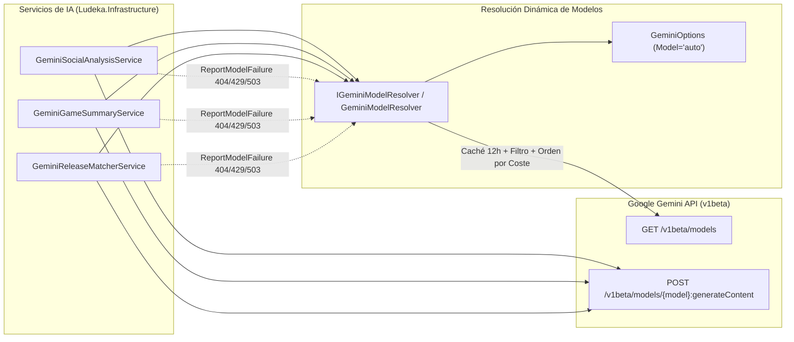

# Diseño Técnico: `IGeminiModelResolver` y Cascada Dinámica por Precio (INC-150)

## 1. Arquitectura de Componentes



## 2. Contrato `IGeminiModelResolver`

Ubicación: `src/Ludeka.Infrastructure/Services/IGeminiModelResolver.cs`

```csharp
using System.Collections.Generic;
using System.Net;
using System.Threading;
using System.Threading.Tasks;

namespace Ludeka.Infrastructure.Services;

public interface IGeminiModelResolver
{
    Task<IReadOnlyList<string>> GetCandidateModelsAsync(CancellationToken ct = default);
    void ReportModelFailure(string model, HttpStatusCode? statusCode);
}
```

## 3. Reglas de Clasificación, Ordenación y Cooldown en `GeminiModelResolver`

1. **Expresión Regular de Elegibilidad:**
   - `^gemini-(?<version>\d+(?:\.\d+)?)-(?<tier>flash-lite|flash)$` (sobre el identificador limpio sin `"models/"`).
   - Se parsea `version` con `decimal.TryParse(..., CultureInfo.InvariantCulture)` y se exige `version >= 3.5m`.
   - Si el objeto JSON del modelo en `/v1beta/models` incluye `supportedGenerationMethods`, se verifica que contenga `"generateContent"`.
2. **Función de Coste y Versión:**
   - `CostTier`: `tier == "flash-lite" ? 1 : 2`.
   - Ordenación: `.OrderBy(m => m.CostTier).ThenByDescending(m => m.Version)`.
   - Ejemplo con el catálogo actual de Google:
     1. `gemini-3.5-flash-lite` (Tier 1, v3.5 — $0.30/1M input)
     2. `gemini-3.8-flash` (Tier 2, v3.8 — $0.75/1M input)
     3. `gemini-3.7-flash` (Tier 2, v3.7 — $0.75/1M input)
     4. `gemini-3.6-flash` (Tier 2, v3.6 — $0.75/1M input)
     5. `gemini-3.5-flash` (Tier 2, v3.5 — $1.50/1M input)
3. **Gestión de Estado y Concurrencia:**
   - `GeminiModelResolver` mantiene en un `ConcurrentDictionary<string, ModelPenaltyState>` (insensible a mayúsculas) el estado de penalización de cada modelo y utiliza un `SemaphoreSlim(1, 1)` para refrescar la lista de `/v1beta/models` cada 12 horas (o 15 minutos si el intento de refresco previo falló).
   - Se inyecta un `TimeProvider` opcional en el constructor para permitir pruebas unitarias deterministas de expiración de caché y *cooldown*.
   - Registro en DI (`LudekaServiceCollectionExtensions.cs`):
     - Se registra un `GeminiModelCacheState` como `Singleton` (o `GeminiModelResolver` con `IHttpClientFactory` como `Singleton`) para que el catálogo descubierto y los *cooldowns* se compartan entre todas las peticiones web y lotes en ejecución dentro del mismo proceso.

## 4. Compatibilidad con constructores y pruebas existentes

- En `GeminiSocialAnalysisService`, `GeminiGameSummaryService` y `GeminiReleaseMatcherService`, el parámetro `IGeminiModelResolver? modelResolver = null` se añade como parámetro opcional al final del constructor.
- Si `modelResolver` está presente (inyección por contenedor DI o pruebas específicas), se invoca `await _modelResolver.GetCandidateModelsAsync(ct)` y se notifican los fallos mediante `_modelResolver.ReportModelFailure(model, response.StatusCode)`.
- Si `modelResolver` es `null` (pruebas unitarias legadas que instancian el servicio manualmente con un `FakeHttpMessageHandler`), el servicio utiliza `_options.GetModelCandidateChain()` sin emitir llamadas adicionales a `GET /v1beta/models`.
