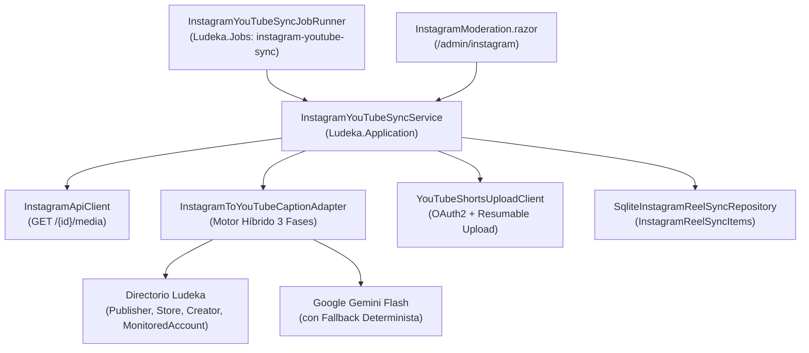

# Diseño Técnico SDD: Sincronización Automática de Reels de Instagram a YouTube Shorts (INC-150)

## 1. Arquitectura de Componentes



---

## 2. Modelo de Datos y Persistencia Dual (SQLite + PostgreSQL)

### 2.1. Entidad `InstagramReelSyncItem` (`src/Ludeka.Core/Entities/InstagramReelSyncItem.cs`)
- `Id` (`Guid`, PK)
- `InstagramMediaId` (`string`, máx. 100, requerido, índice único `IX_InstagramReelSyncItems_InstagramMediaId`)
- `InstagramPermalink` (`string`, máx. 500, requerido)
- `Caption` (`string?`, texto original en Instagram)
- `MediaPublishedAtUtc` (`DateTimeOffset`, fecha de publicación del Reel en Instagram)
- `Status` (`InstagramReelSyncStatus`: `Pending = 0`, `Uploaded = 1`, `Failed = 2`, `Skipped = 3`)
- `GeneratedYouTubeTitle` (`string?`, máx. 120)
- `GeneratedYouTubeDescription` (`string?`)
- `YouTubeVideoId` (`string?`, máx. 64)
- `YouTubeUrl` (`string?`, máx. 500)
- `AttemptCount` (`int`, por defecto 0)
- `LastError` (`string?`, máx. 1000)
- `CreatedAtUtc` (`DateTimeOffset`)
- `SyncedAtUtc` (`DateTimeOffset?`)

> **Nota sobre SQLite y `DateTimeOffset`:** Siguiendo la regla establecida en INC-34, las ordenaciones sobre `MediaPublishedAtUtc` y `CreatedAtUtc` en `SqliteInstagramReelSyncRepository` se realizan en memoria tras materializar la colección acotada o convirtiendo apropiadamente para evitar errores de `ORDER BY DateTimeOffset` en SQLite.

---

## 3. Algoritmo del Motor Híbrido de Menciones (`InstagramToYouTubeCaptionAdapter`)

### Paso 1: Resolución en Directorio de Ludeka
1. Se buscan todas las ocurrencias de `@([a-zA-Z0-9._]{2,40})` (excluyendo correos electrónicos).
2. Se cargan las entidades de `Publisher`, `Store`, `Creator` y `MonitoredSocialAccount`.
3. Para cada mención `@igHandle`:
   - Se normaliza `cleanIg = igHandle.TrimStart('@').TrimEnd('.').ToLowerInvariant()`.
   - Se busca en `Publishers`, `Stores` y `Creators` si algún `SocialLinks` con `Platform == SocialPlatform.Instagram` tiene `ExtractHandle(link) == cleanIg`, o si `entity.Slug == cleanIg`.
   - Si se encuentra la entidad en el directorio:
     - Se busca su enlace de YouTube (`entity.GetYouTubeLink()`).
     - Si tiene enlace de YouTube, se extrae el `@ytHandle` (ej. de `https://www.youtube.com/@DevirTV` ➔ `@DevirTV`) y se define `ReplacementText = $"{entity.Name} ({ytHandle})"` (o `ytHandle` si ya está precedido del nombre).
     - Si no tiene enlace de YouTube, se define `ReplacementText = entity.Name` (ej. `"Zacatrus"`).
     - Se registra el enlace canónico a su ficha en Ludeka (`https://ludeka.es/tiendas/{slug}`, `https://ludeka.es/editoriales/{slug}`, `https://ludeka.es/creadores/{slug}`).
   - Si no está en `Publishers`/`Stores`/`Creators`, se busca en `MonitoredSocialAccounts` donde `Platform == SocialPlatform.Instagram` y `HandleOrChannelId` coincida con `cleanIg`. Si existe, se usa su `Name` oficial (y si existe otra `MonitoredSocialAccount` con el mismo `Name` y `Platform == SocialPlatform.YouTube`, se usa su handle de YouTube).

### Paso 2: Adaptación Asistida con Google Gemini Flash
- Si `!GeminiOptions.ShouldSimulate` y existe `GeminiOptions.ApiKey`:
  - Se invoca `generateContent` con `responseMimeType = "application/json"` y temperatura `0.2`, pasándole:
    - El `caption` original de Instagram.
    - La lista de menciones ya resueltas en el Paso 1 (indicándole que debe usar esos reemplazos exactos).
    - La instrucción de transformar cualquier otro `@handle` no resuelto en su nombre comercial limpio sin `@`, eliminar referencias a *"link en bio"* y generar un título atractivo de $\le 88$ caracteres.
- **Fallback determinista (o posprocesado de seguridad):**
  - Se asegura que ninguna mención resuelta en el Paso 1 quede con su `@handle` de Instagram original.
  - Cualquier `@handle` restante de Instagram que no sea un handle de YouTube resuelto se limpia a formato legible (`@maldito_games` ➔ `Maldito Games`).
  - Se garantiza que el título no supere los 100 caracteres e incluya `#Shorts`.

### Paso 3: Ensamblado del Pie Determinista hacia `ludeka.es`
Se añade al final de la descripción:
```text

━━━━━━━━━━━━━━━━━━━━
🎲 Enlaces en Ludeka:
• [Nombre Editorial/Tienda]: https://ludeka.es/editoriales/slug  (si se detectaron en el post)
👉 Juegos, sorteos, eventos y comparador de precios en tu mesa: https://ludeka.es

#Shorts #JuegosDeMesa #BoardGames #Ludeka
```

---

## 4. Protocolo de Subida a YouTube Data API v3 (`YouTubeShortsUploadClient`)

1. **Obtención de Access Token OAuth 2.0:**
   - `POST https://oauth2.googleapis.com/token` con `FormUrlEncodedContent`:
     - `client_id`: `YouTube:OAuthClientId` (o fallback a `Authentication:Providers:Google:ClientId` si se comparte el mismo cliente OAuth de GCP)
     - `client_secret`: `YouTube:OAuthClientSecret` (o fallback a `Authentication:Providers:Google:ClientSecret`)
     - `refresh_token`: `YouTube:OAuthRefreshToken`
     - `grant_type`: `"refresh_token"`
2. **Descarga del stream de vídeo desde Instagram:**
   - `GET {media_url}` obteniendo el stream binario MP4 y su `Content-Length`.
3. **Inicio de sesión Resumable Upload en YouTube:**
   - `POST https://www.googleapis.com/upload/youtube/v3/videos?uploadType=resumable&part=snippet,status`
   - Cabeceras:
     - `Authorization: Bearer {access_token}`
     - `X-Upload-Content-Type: video/mp4`
     - `X-Upload-Content-Length: {bytes.Length}`
   - Cuerpo JSON:
     ```json
     {
       "snippet": {
         "title": "...",
         "description": "...",
         "categoryId": "20",
         "defaultLanguage": "es",
         "defaultAudioLanguage": "es"
       },
       "status": {
         "privacyStatus": "public",
         "selfDeclaredMadeForKids": false
       }
     }
     ```
4. **Transferencia de bytes del MP4:**
   - `PUT {uploadSessionUri}` (leído de `response.Headers.Location`) con `ByteArrayContent` / `StreamContent` (`video/mp4`).
   - Deserialización del JSON de respuesta para extraer `id` (`YouTubeVideoId`).
