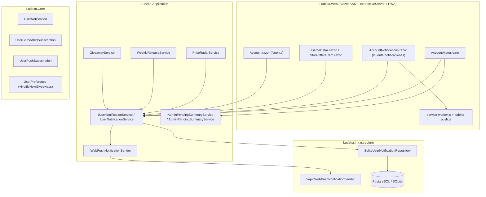

# Diseño Arquitectónico: Sistema de Avisos, Campana de Notificaciones, Web Push y Contador Administrativo Real (INC-149)

## 1. Visión General por Capas (Clean Architecture)

## 2. Modelo de Dominio (`src/Ludeka.Core`)

### 2.1. Enumeraciones
- `UserNotificationType`:
  - `PriceDrop = 0` (Bajada de precio $\ge 15\%$ sobre PVP base)
  - `Reprint = 1` (Reimpresión detectada)
  - `Restock = 2` (Reestock disponible en tienda)
  - `NewGiveaway = 3` (Nuevo sorteo publicado)
  - `System = 4` (Aviso general del sistema)
- `GameAlertType`:
  - `PriceDrop = 0`
  - `Reprint = 1`
  - `Restock = 2`

### 2.2. Entidades Nuevas y Modificadas
- **`UserNotification`** (`src/Ludeka.Core/Entities/UserNotification.cs`):
  - `Id` (`Guid`), `UserId` (`string`), `Type` (`UserNotificationType`), `Title` (`string`), `Message` (`string`), `TargetUrl` (`string`), `GameId` (`Guid?`), `ImageUrl` (`string?`), `IsRead` (`bool`), `CreatedAtUtc` (`DateTime`), `ReadAtUtc` (`DateTime?`).
  - Método de dominio `MarkAsRead(DateTime? readAtUtc = null)` que establece `IsRead = true` y `ReadAtUtc`.
- **`UserGameAlertSubscription`** (`src/Ludeka.Core/Entities/UserGameAlertSubscription.cs`):
  - `Id` (`Guid`), `UserId` (`string`), `GameId` (`Guid`), `AlertType` (`GameAlertType`), `ReferenceBasePvp` (`decimal?`), `LastNotifiedPrice` (`decimal?`), `LastNotifiedAtUtc` (`DateTime?`), `CreatedAtUtc` (`DateTime`).
  - Restricción única compuesta por `(UserId, GameId, AlertType)`.
- **`UserPushSubscription`** (`src/Ludeka.Core/Entities/UserPushSubscription.cs`):
  - `Id` (`Guid`), `UserId` (`string`), `Endpoint` (`string`), `P256dh` (`string`), `Auth` (`string`), `UserAgent` (`string?`), `CreatedAtUtc` (`DateTime`).
  - Restricción única por `(UserId, Endpoint)`.
- **`UserPreference`** (`src/Ludeka.Core/Entities/UserPreference.cs`):
  - Se añade `public bool NotifyNewGiveaways { get; set; }` (por defecto `false`).

## 3. Cálculo del PVP Base y Regla del $\ge 15\%$
Para evaluar de forma determinista si una oferta supone al menos un $15\%$ de rebaja sobre el PVP base:
1. Si la suscripción `UserGameAlertSubscription` registró un `ReferenceBasePvp > 0` o se proporciona un PVP de referencia, se considera como candidato junto con el mayor precio oficial/histórico registrado del juego (`maxStorePrice` entre `game.PurchaseLinks` y `metrics.HighestPrice`).
2. $\text{PvpBase} = \max(\text{ReferenceBasePvp}, \text{MaxPrecioTienda}, \text{PrecioMedioHistorico})$.
3. Condición de disparo: `offer.InStock && basePvp > 0 && offer.Price <= Math.Round(basePvp * 0.85m, 2)`.
4. Para evitar spam ante fluctuaciones idénticas, si `LastNotifiedPrice.HasValue && offer.Price >= LastNotifiedPrice.Value`, no se vuelve a emitir la misma alerta hasta que baje aún más o el usuario reactive la alerta.

## 4. Persistencia y Guardas de Esquema
- **Tablas nuevas en `LudekaDbContext` (`src/Ludeka.Infrastructure/Data/LudekaDbContext.cs`):**
  1. `UserNotifications`
  2. `UserGameAlertSubscriptions`
  3. `UserPushSubscriptions`
- **Columna nueva en `UserPreferences`:**
  - `NotifyNewGiveaways` (`boolean NOT NULL DEFAULT FALSE`).
- **Sincronización obligatoria de esquema:**
  - Nueva migración EF Core (`20260414180000_AddUserNotificationsAndAlerts`).
  - Actualización de `SqliteSchemaMigrator.cs` (`CREATE TABLE IF NOT EXISTS` y `ALTER TABLE UserPreferences ADD COLUMN NotifyNewGiveaways`).
  - Actualización de `docs/database/supabase_schema.sql`.
  - Actualización de `PostgresSchemaVerificationTests.cs` (`TablasEsperadas = 46`, `MigracionesEsperadas = 26`).

## 5. Web Push (W3C Push API + VAPID)
- Se implementa `VapidWebPushNotificationSender` utilizando `ECDiffieHellman` / `ECDsa` nativos de .NET 10 (`System.Security.Cryptography`) para firmar tokens JWT VAPID (`alg: ES256`) y enviar peticiones HTTP Push a los endpoints de los navegadores o PWAs móviles, con degradación elegante (no lanza excepción al flujo de negocio si un endpoint ha expirado o las claves VAPID son de entorno local).
- Si no se configuran claves VAPID explícitas en `appsettings.json`, se provee un par de claves VAPID ECDSA P-256 válidas de desarrollo por defecto en `WebPushOptions` para que la suscripción en navegador/PWA funcione de inmediato en local y pruebas.
